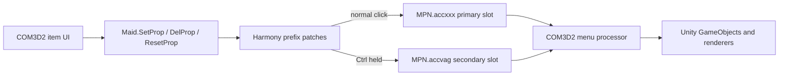
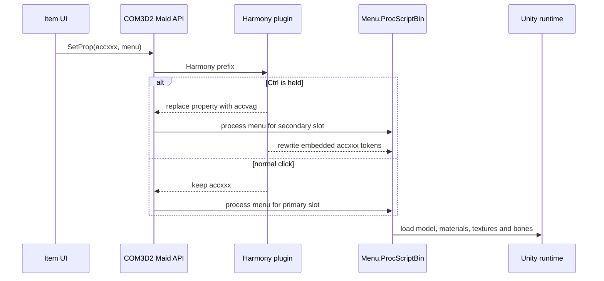
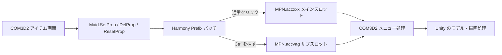
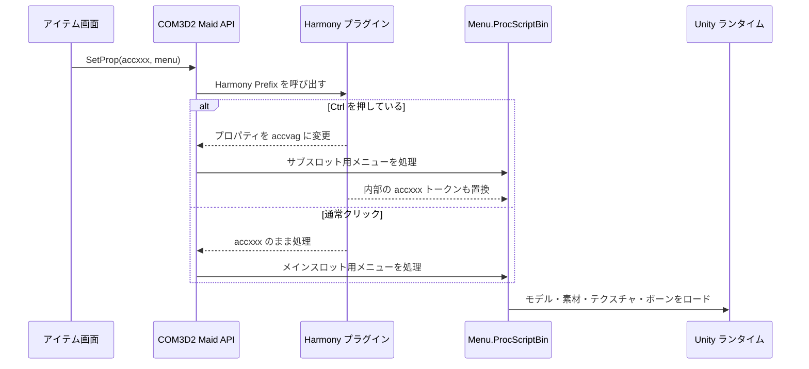

# COM3D2 Double Front Whole Accessory

[](https://github.com/nanashi-187/COM3D2_Double_Front_Hole_Accessory/releases/latest)

A BepInEx plugin for COM3D2 that allows two front-hole accessories to remain equipped at the same time.

## Requirements

- COM3D2 (64-bit)
- BepInEx 5

## Installation

[Download the latest release package](https://github.com/nanashi-187/COM3D2_Double_Front_Hole_Accessory/releases/latest)

Download `COM3D2.DoubleFrontWhole.Accessory-0.3.1.zip`, extract it, then copy `COM3D2.DoubleFrontHole.dll` into:

```text
COM3D2/BepInEx/plugins/
```

Restart the game after installing or updating the plugin.

## Usage

1. Equip the first front-hole accessory normally.
2. Hold `Ctrl` and select the second front-hole accessory.
3. Use the game's normal selection flow to replace the primary accessory.

## Building

From PowerShell:

```powershell
.\build.ps1 -GamePath 'C:\Games\COM3D2'
```

The DLL is written to `bin/COM3D2.DoubleFrontHole.dll` by default. The script uses the Visual Studio 2022 Build Tools Roslyn compiler when installed and otherwise falls back to the .NET Framework `csc.exe` that ships with Windows, so the sources are kept C# 5 compatible. Pass `-CscPath` to choose a compiler explicitly.

## Notes

- The plugin does not modify game or mod asset files.
- Compatibility depends on the accessory's menu/model implementation. Report reproducible combinations with the BepInEx log.
- For livelier swinging of front-hole chains (both slots), install [COM3D2 Accessory Physics](https://github.com/nanashi-187/COM3D2_Accessory_Physics). The swing settings that 0.4.0 added here moved there in 0.5.0.

## License

Nanashi-187 Non-Commercial No-Derivatives Software License 1.0. See `LICENSE` for the complete terms.

---

## 日本語

`COM3D2.DoubleFrontHole` は、COM3D2 で前穴アクセサリーを2つ同時に装着できるようにする BepInEx プラグインです。

### 必要環境

- COM3D2（64ビット版）
- BepInEx 5

### インストール

`COM3D2.DoubleFrontHole.dll` を次のフォルダーへコピーしてください。

```text
COM3D2/BepInEx/plugins/
```

インストールまたは更新後、ゲームを再起動してください。

### 使用方法

1. 1つ目の前穴アクセサリーを通常どおり装着します。
2. `Ctrl` キーを押しながら、2つ目の前穴アクセサリーを選択します。
3. 1つ目のアクセサリーを変更する場合は、通常どおり別のアクセサリーを選択します。

### 2つ目のアクセサリーを外す方法

`Ctrl` キーを押しながら、前穴アクセサリー一覧の「なし／解除」アイテムを選択してください。1つ目のアクセサリーを残したまま、2つ目だけを外します。

### ビルド

PowerShell から次のコマンドを実行します。

```powershell
.\build.ps1 -GamePath 'C:\Games\COM3D2'
```

既定では DLL が `bin/COM3D2.DoubleFrontHole.dll` に出力されます。Visual Studio 2022 Build Tools の Roslyn コンパイラーがあればそれを使用し、なければ Windows 標準の .NET Framework `csc.exe` を使用します（そのためソースは C# 5 互換です）。`-CscPath` でコンパイラーを指定することもできます。

### 注意事項

- ゲーム本体や MOD のアセットファイルは変更しません。
- 互換性は各アクセサリーのメニューおよびモデル実装に依存します。
- 前穴アクセサリー（両スロット）のチェーンをより大きく揺らすには [COM3D2 Accessory Physics](https://github.com/nanashi-187/COM3D2_Accessory_Physics) を導入してください。0.4.0 で追加した揺れ設定は 0.5.0 でそちらへ移動しました。
- 問題を報告する場合は、再現できるアクセサリーの組み合わせと BepInEx のログを添付してください。

---

## Architecture

### Runtime layers



- **BepInEx** loads the DLL and calls `Awake()` through `BaseUnityPlugin`.
- **Harmony** intercepts the relevant overloads of `Maid.SetProp`, `Maid.DelProp`, `Maid.ResetProp`, and `Menu.ProcScriptBin` before COM3D2 executes them.
- **COM3D2** normally routes front-hole menu data through `MPN.accxxx`. With `Ctrl` held, the plugin changes that property to `MPN.accvag`, an existing independent accessory slot.
- **Unity** is still responsible for loading, rendering, animating, and destroying the accessory. This plugin does not clone or manually update Unity objects.

### Menu-byte rewriting

COM3D2 menu files can contain the slot name inside their binary script. Changing only the `Maid.SetProp` argument is therefore insufficient: the menu could route itself back to `accxxx`. For secondary selection, the plugin copies the script byte array and replaces complete `accxxx`/`accXXX` tokens with `accvag`/`accVag` before `Menu.ProcScriptBin` parses it.



### APIs used

| Layer | API | Purpose |
| --- | --- | --- |
| BepInEx | `BaseUnityPlugin`, `BepInPlugin` | Plugin discovery and startup |
| Harmony | `HarmonyPatch`, `HarmonyPrefix` | Modify COM3D2 calls without editing game assemblies |
| COM3D2 | `Maid.SetProp`, `DelProp`, `ResetProp` | Route equip, remove, and reset operations |
| COM3D2 | `Menu.ProcScriptBin` | Rewrite the menu script before it chooses a slot |
| COM3D2 | `MPN.accxxx`, `MPN.accvag` | Primary and secondary property slots |
| Unity | `Input.GetKey` | Detect left or right `Ctrl` |

## アーキテクチャ（日本語）

このプラグインは Unity オブジェクトを複製しません。BepInEx から読み込まれ、Harmony で COM3D2 の `Maid` API とメニュー処理をフックし、`Ctrl` キーが押されている場合だけ前穴アクセサリーの処理先を `MPN.accxxx` から独立した `MPN.accvag` スロットへ変更します。

COM3D2 のメニューバイナリ内にもスロット名が含まれる場合があるため、`Menu.ProcScriptBin` の直前でバイト配列をコピーし、完全一致する `accxxx` トークンを `accvag` に置換します。その後のモデル、マテリアル、テクスチャ、ボーン、表示および削除処理は COM3D2 と Unity が通常どおり担当します。

通常クリックでは既定の `accxxx` を使用し、`Ctrl` を押した操作だけ `accvag` に送られます。このため、装着だけでなく解除とリセットも同じ2スロット構成で処理できます。

### 日本語ビジュアルガイド



上図は操作から描画までの経路を示します。通常クリックは `accxxx` に入り、`Ctrl` を押した操作だけ Harmony パッチによって `accvag` に振り分けられます。モデルを独自に複製するのではなく、COM3D2 と Unity の標準ロード・描画・削除処理をそのまま利用します。



上図は1回の装着処理の順序です。COM3D2 のメニューバイナリ自身が `accxxx` を指定する場合があるため、API 引数だけでなく `Menu.ProcScriptBin` に渡るバイト列内の完全一致トークンも置換します。これにより、メニュー処理がアクセサリーをメインスロットへ戻してしまうことを防ぎます。
## Current Release Name / 現在のリリース名

The current BepInEx display name is **COM3D2 Double Front Whole Accessory**, version **0.5.0**. The DLL filename and stable plugin GUID remain unchanged for upgrade compatibility.

現在の BepInEx 表示名は **COM3D2 Double Front Whole Accessory**、バージョンは **0.5.0** です。アップグレード互換性を保つため、DLL ファイル名とプラグイン GUID は変更していません。

## License Update / ライセンス更新

Use is permitted only under the repository's **Nanashi-187 Non-Commercial No-Derivatives Software License 1.0**. See `LICENSE` for the complete terms.

利用条件は、リポジトリの **Nanashi-187 Non-Commercial No-Derivatives Software License 1.0** に従います。完全な条件は `LICENSE` を参照してください。

## 0.6.0: Third front-hole slot / 3つ目の前穴スロット

Version **0.6.0** adds a third front-hole slot, so up to three front-hole accessories can be worn at once. This section supersedes the version number above.

### Requirements for the third slot

- ExternalSaveData (`COM3D2.ExternalSaveData.Managed.dll` in `Sybaris/`) to keep the third accessory in the save. Without it the third slot still works, but only until the game is closed.

### Usage

| Click | Slot |
| --- | --- |
| Normal click | 1st (primary, `accxxx`) |
| `Ctrl` + click | 2nd (`accvag`) |
| `Alt` + click | 3rd (plugin slot `accXXX3`) |

- **Remove only the third accessory:** hold `Alt` and select the "none / remove" item of the front-hole list.
- Menus made for the second slot (`accVag`) also go to the third slot with `Alt`.
- The third accessory is stored per maid and loaded again after loading a save, changing scenes or rebuilding the outfit.
- Set `EnableThirdSlot = false` in `BepInEx/config/local.com3d2.doublefronthole.cfg` to turn the third slot off, or `ThirdSlotKey` to use another key (restart required). Avoid `LeftShift`: ShiftClickExplorer opens the item's folder or file on Shift and Ctrl+Shift clicks.

### Limits of the third slot

- It is not a game property: presets (`.preset`) and the game's own save data do not include it. It is kept in the ExternalSaveData file next to the save (`*.exsave.xml`).
- Removing the plugin simply drops the third accessory. Saves still load normally.
- `.menu` items are fully supported. For `.mod` items only the model is moved to the third slot; their material and texture changes may apply to the primary slot.
- Menus that use `anime` or `toelock` with the slot name may not animate in the third slot.

### How it works

At startup the plugin appends a new body slot `accXXX3` to COM3D2's slot table (`TBody.m_strDefSlotName`) before any maid is created. An `Alt` click is intercepted in `Maid.SetProp`, so the primary `accxxx` property is not changed. The plugin loads the menu itself with `Menu.ProcScript`, rewriting slot names `accxxx`/`accXXX` (and `accVag`, so slot-2 versions of an item work too) in the menu script to `accXXX3` (the `category` line keeps `accxxx`, because the game parses it as a property). The file name is saved with ExternalSaveData and checked every half second for each active maid, so it comes back after body rebuilds.

### 3つ目のスロット（日本語）

バージョン **0.6.0** で3つ目の前穴スロットを追加し、前穴アクセサリーを最大3つ同時に装着できるようになりました。上記のバージョン表記より、この節が優先されます。

#### 必要環境

- 3つ目のアクセサリーをセーブに残すには ExternalSaveData（`Sybaris/` 内の `COM3D2.ExternalSaveData.Managed.dll`）が必要です。無い場合でも3つ目のスロットは使えますが、ゲームを終了すると消えます。

#### 使用方法

| 操作 | スロット |
| --- | --- |
| 通常クリック | 1つ目（メイン、`accxxx`） |
| `Ctrl` + クリック | 2つ目（`accvag`） |
| `Alt` + クリック | 3つ目（プラグインのスロット `accXXX3`） |

- **3つ目だけ外す:** `Alt` を押しながら、前穴アクセサリー一覧の「なし／解除」アイテムを選択します。
- 2つ目用（`accVag`）に作られたメニューも、`Alt` クリックで3つ目のスロットに入ります。
- 3つ目のアクセサリーはメイドごとに記録され、セーブのロード、シーン移動、衣装の再構築の後に自動で再装着されます。
- `BepInEx/config/local.com3d2.doublefronthole.cfg` の `EnableThirdSlot = false` で3つ目のスロットを無効に、`ThirdSlotKey` で使うキーを変更できます（再起動が必要）。ShiftClickExplorer は Shift と Ctrl+Shift のクリックでフォルダーやファイルを開くため、`LeftShift` は避けてください。

#### 制限事項

- ゲームのプロパティではないため、プリセット（`.preset`）とゲーム本体のセーブデータには含まれません。セーブの横の ExternalSaveData ファイル（`*.exsave.xml`）に保存されます。
- プラグインを外すと3つ目のアクセサリーが外れるだけで、セーブは通常どおりロードできます。
- `.menu` 形式のアイテムに対応しています。`.mod` 形式ではモデルだけが3つ目のスロットに入り、マテリアルやテクスチャの変更はメインスロットに適用される場合があります。
- スロット名を指定する `anime` や `toelock` を使うメニューは、3つ目のスロットではアニメーションしない場合があります。
